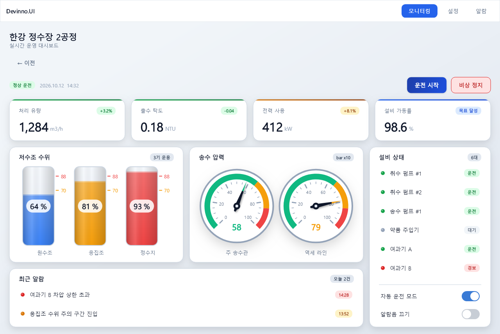
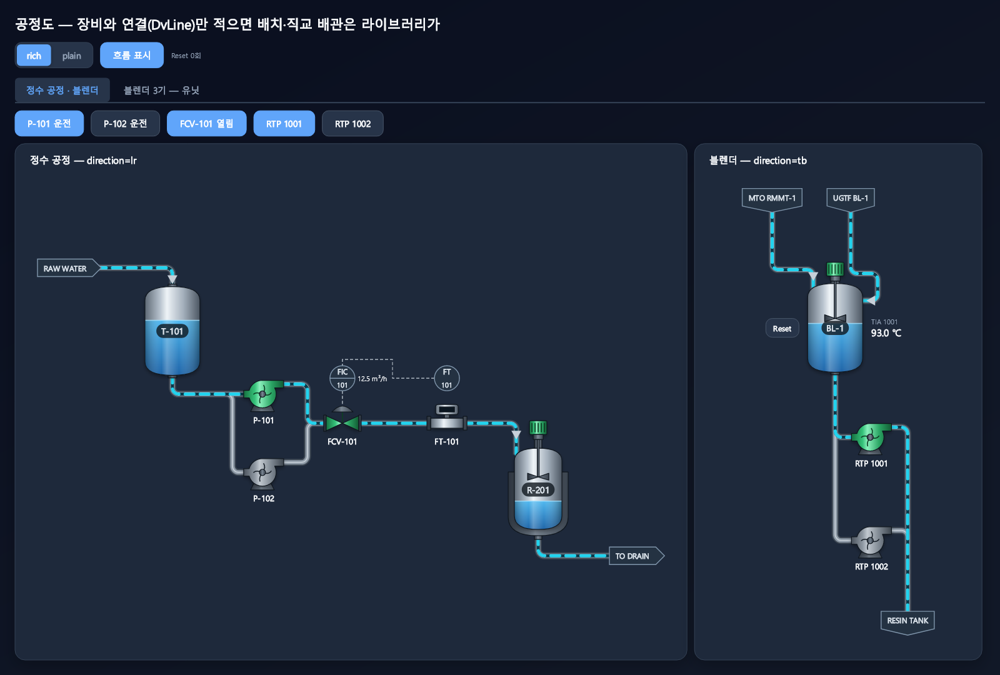

<!-- en-hash: e3b0c44298fc1c14 -->
# Devinno.UI
<!-- en-hash: 353b2ea8e52b4206 -->

[English](README.md) | 한국어

SkiaSharp 기반 .NET UI 라이브러리입니다(.NET 9 이상). 산업용 HMI(터치 패널)와 일반 앱 화면을 대상으로 합니다.

화면은 CSS 스타일 인라인 `style`을 쓰는 XML 마크업으로 작성하고, C# 뷰모델(VM)에 바인딩합니다. 마크업은 런타임에 파싱되므로 빌드 없이 바로 렌더링됩니다.

> 현재 최초 버전을 개발 중입니다. API는 바뀔 수 있습니다.





## 설치
<!-- en-hash: d25576ef9e644f52 -->

앱은 코어 패키지와, 화면을 창에 올리는 호스트 어댑터 하나를 참조합니다.

```bash
dotnet add package Devinno.UI
dotnet add package Devinno.UI.OpenTK      # own window (ViewWindow)
# or
dotnet add package Devinno.UI.WinForms    # inside a WinForms form (ViewControl)
```

## 시작하기
<!-- en-hash: 5a2afa9cf5286a29 -->

화면 한 장 = `DvPage` 를 상속한 클래스 + 같은 이름의 `.dvml`. `DvApp` 이 페이지를 담아 창(OpenTK `ViewWindow` 또는 WinForms `ViewControl`)에 올립니다.

```csharp
using Devinno.UI.App;
using Devinno.UI.OpenTK;
using Devinno.UI.Styling;

var app = new DvApp { Theme = DvTheme.Dark };
app.Pages.Add(new HomePage());          // while no page is current, the first page added is shown (start page)
app.Pages.Add(new AlarmPage());
app.Top = new MainTopBar();             // optional: fixed areas such as a top bar or a sidebar (Left)
using var window = new ViewWindow(app, 1280, 800, "My HMI");
window.Run();
```

페이지 안에서는 `App.Show<AlarmPage>()` 로 전환합니다. 자세한 내용은 [`dvml-ui-markup.md`](dvml-ui-markup.md) 16장을 보세요.

## 문서
<!-- en-hash: 88f1c1c76690d150 -->

아래 문서는 패키지의 `docs/` 폴더에 들어 있습니다(빌드하면 프로젝트의 `.devinno/Devinno.UI/` 에도 복사됩니다 — 아래 참고). 영어로만 제공됩니다.

- [`llm-rules.md`](llm-rules.md): 작성 규칙 — 원칙, CSS 와 다른 점, 자주 하는 실수, 화면 확인 방법 (먼저 읽기)
- [`dvml-ui-markup.md`](dvml-ui-markup.md): 마크업 레퍼런스 — 태그·속성·스타일 키·테마 토큰
- [`dvml-process.md`](dvml-process.md): 공정도(P&ID) 작성 가이드 — `DvProcess` 장비·연결·배치 규칙·사용자 심볼
- [`llms.txt`](llms.txt): AI 도구용 진입점 (위 문서들의 읽는 순서)
- C# API: XML 문서 주석 (IntelliSense, 패키지의 `Devinno.UI.xml`. 한국어 Visual Studio 에서는 한국어 설명이 보입니다)

## AI 도구용 문서
<!-- en-hash: 5ca825fde6296bbd -->

Devinno.UI 를 참조한 프로젝트를 빌드하면 패키지 문서와 영어 IntelliSense XML 이 프로젝트 폴더의 `.devinno/Devinno.UI/` 로 복사됩니다(SDK 스타일 프로젝트, `restore` 만으로는 안 생기고 첫 `dotnet build` 뒤에 생김). Devinno 패키지마다 자기 하위 폴더를 씁니다.

- AI 지시 파일(`CLAUDE.md`, `AGENTS.md` 등)에 이 한 줄을 넣으세요: `Devinno library docs: read .devinno/*/llms.txt first.`
- 복사 끄기: 프로젝트 파일에 `<DevinnoCopyDocs>false</DevinnoCopyDocs>`
- `.gitignore` 에 `.devinno/` 를 넣는 것을 권장합니다(빌드할 때마다 다시 만들어짐).

## 저장소 구성
<!-- en-hash: 772a5a2096738648 -->

| 경로 | 설명 |
|---|---|
| `src/Devinno.UI` | 코어 라이브러리 (마크업 파서, 레이아웃, 렌더링, 컴포넌트) |
| `src/Devinno.UI.OpenTK` | OpenTK 호스트 (`ViewWindow`) |
| `src/Devinno.UI.WinForms` | WinForms 호스트 (`ViewControl`) |
| `tests/Devinno.UI.Tests` | xUnit 테스트 |
| `samples/Devinno.UI.Demo` | OpenTK 데모 앱 (`-- top`, `-- nav` 로 앱 모델 확인) |
| `samples/Devinno.UI.Demo.WinForms` | WinForms 데모 앱 |

## 라이선스
<!-- en-hash: 2b551ca10d5c3869 -->

MIT ([`LICENSE`](LICENSE)). 제3자 고지(Font Awesome Free 6.1.2 아이콘 폰트: 폰트 SIL OFL 1.1, 아이콘 CC BY 4.0): [`THIRD-PARTY-NOTICES.md`](THIRD-PARTY-NOTICES.md), 패키지에도 포함됩니다.


