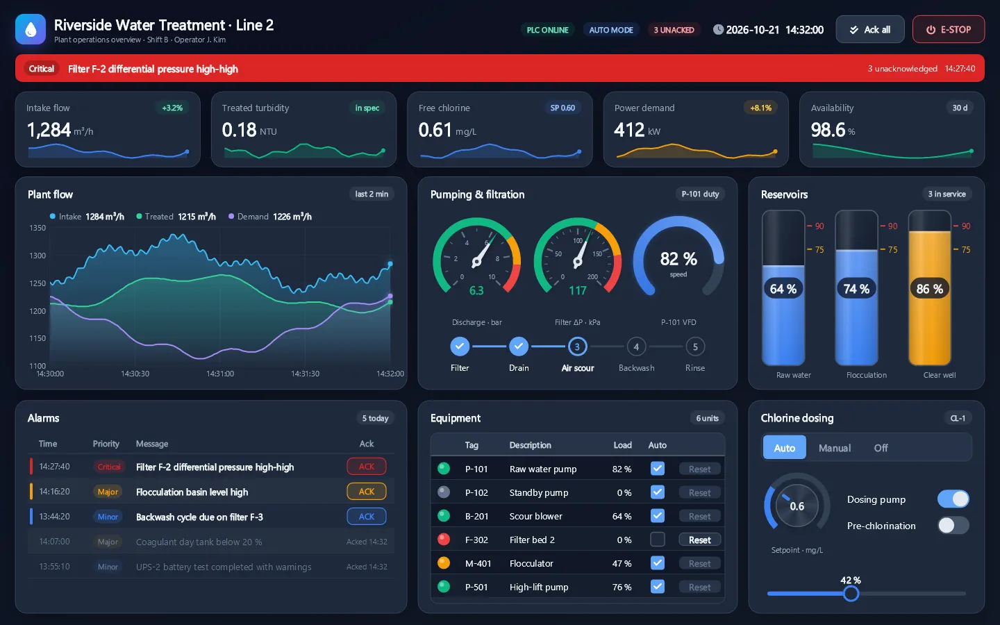
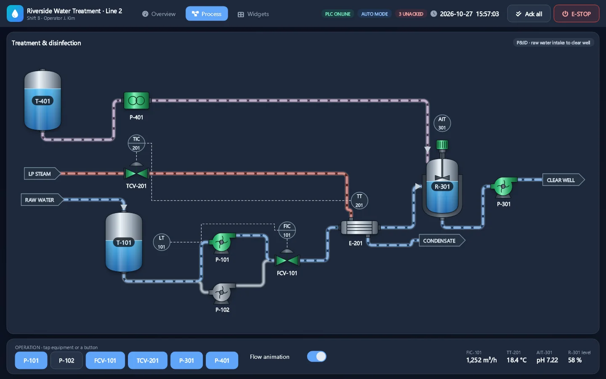

<!-- en-hash: e3b0c44298fc1c14 -->
# Devinno.UI
<!-- en-hash: f43cb2f2b8ebd792 -->

[English](README.md) | 한국어

SkiaSharp 기반 .NET UI 라이브러리입니다(.NET 9 이상). 산업용 HMI(터치 패널)와 일반 앱 화면을 대상으로 합니다.

화면은 CSS 스타일 인라인 `style`을 쓰는 XML 마크업으로 작성하고 C# 뷰모델(VM)에 바인딩합니다. 마크업은 런타임에 파싱되므로 빌드 없이 바로 렌더링됩니다.

> 현재 최초 버전을 개발 중입니다. API는 바뀔 수 있습니다.





## 마크업으로 쓴 화면
<!-- en-hash: 9c19b1a9c0eeb1a3 -->

화면 하나는 `.dvml` 파일과 이름이 같은 C# 클래스입니다. 클래스가 뷰모델이라 `{Temperature}` 는 그 속성을 보여 주고 `onclick="EditSetpoint"` 는 그 메서드를 부릅니다. 이 페이지는 `samples/Devinno.UI.AppSample` 에서 가져왔습니다(README 와 샘플이 같은지 테스트가 확인합니다).

`MonitorPage.dvml`

```xml
<DvPageFrame vm="MonitorPage" title="Monitoring" subtitle="Shown: {ShownCount}">
  <DvRow>
    <DvButton variant="ghost" text="← Back" onclick="Back"/>
  </DvRow>
  <DvCard title="Water temperature">
    <DvLabel class="title" text="{Temperature} ℃"/>
    <DvRow>
      <DvLabel class="body muted" text="Setpoint {Setpoint} ℃"/>
      <DvButton variant="secondary" text="Change setpoint" onclick="EditSetpoint"/>
    </DvRow>
  </DvCard>
</DvPageFrame>
```

`MonitorPage.cs`

```csharp
using Devinno.UI.App;

public sealed partial class MonitorPage : DvPage
{
    public double Temperature { get; set; } = 24.5;
    public double Setpoint { get; private set; } = 25.0;
    public int ShownCount { get; private set; }

    public void Back() => App.Show<HomePage>();

    public async void EditSetpoint()
    {
        double? value = await App.ShowDialog<SetpointDialog, double?>(Setpoint);
        if (value is null)
            return;                 // Cancel button, or closed from outside
        Setpoint = value.Value;     // continues on the input thread: set the VM directly and the screen re-reads it in the same frame
    }

    protected override void OnShown() => ShownCount++;   // every time it is shown
}
```

## 설계 방향: AI와 함께 쓰기 좋은 UI 라이브러리
<!-- en-hash: 4bd456dd744d70c2 -->

Devinno.UI는 AI(LLM) 코딩 도구로 화면을 만드는 것을 전제로 설계했습니다. 목표는 두 가지입니다. AI가 실수를 덜 하게 하고, 실수하면 조용히 넘어가지 않고 바로 드러나게 하는 것입니다. 같은 장치가 사람이 쓸 때도 그대로 도움이 됩니다.

**AI가 이미 아는 문법**
- 화면은 HTML과 비슷한 XML 마크업(`.dvml`)과 CSS 식 `style`로 씁니다. flex·grid·`box-shadow` 같은 익숙한 패턴이 그대로 통하므로 AI가 학습한 지식을 바로 쓸 수 있습니다.
- CSS와 다른 점(기본값, 지원하지 않는 속성)은 한 문서(`llm-rules.md`)에 모았습니다.

**조용한 실패를 드러낸다**
UI 코드에서 가장 흔한 실패는 "틀렸는데 아무 일도 안 일어나는 것"입니다. 이것을 세 겹으로 드러냅니다.
- **빌드 진단(DVML001~018):** 없는 스타일 속성·테마 토큰·클래스, 허용되지 않는 값, VM에 없는 핸들러 메서드, 공정도 연결 오류, 중복 `id`를 dvml의 줄과 칸 위치로 알립니다.
- **컴파일 오류:** `id`를 붙이면 소스 생성기가 VM에 형식 있는 핸들 필드를 만듭니다. 코드에서 이름을 잘못 쓰면 컴파일 오류가 납니다.
- **화면 표시:** 그래도 빠져나간 잘못된 색 토큰은 실행 화면에서 자홍색(`#FF00FF`)으로 보입니다.

**스스로 확인할 수 있다**
- `DvRenderer`로 창 없이 화면을 PNG로 그릴 수 있습니다. AI가 자기가 쓴 화면을 직접 보고 고칠 수 있습니다.
- 이 셋이 모이면 AI가 짧은 고리로 일합니다. (1) `.dvml` 과 VM 을 쓰거나 고치고, (2) 빌드해서 파일·줄·칸을 가리키는 DVML 진단을 고치고, (3) 화면을 PNG로 그려 보고 이상한 곳을 고칩니다.

**문서와 코드가 어긋나지 않는다**
- 원칙은 "문서에 없는 기능은 없는 것"입니다. 마크업 레퍼런스가 태그·속성·값의 전체 목록입니다.
- 문서의 예제는 테스트가 실제로 읽고 그려 보고 컴파일합니다. 문서가 틀리면 테스트가 실패합니다.
- 문서는 패키지에 들어 있고 빌드하면 프로젝트 안 `.devinno/`로 복사되어 AI 도구가 바로 찾습니다(`llms.txt`가 진입점).

**좋은 디자인이 기본값**
- 의미 있는 컴포넌트(`DvCard`, `DvStat`, `DvBadge` 등)와 테마 토큰(`token(surface)` 등)을 쓰면 다크·라이트 테마에서 일관된 화면이 나옵니다. 색을 직접 고르지 않아도 됩니다.
- 공정도(P&ID)는 장비와 연결만 적으면 배치와 직교 배관을 라이브러리가 맡습니다. AI가 좌표를 계산할 필요가 없습니다.

**산업 HMI 현실을 1급으로**
- 데이터와 로직은 VM(앱)이 맡고 위젯은 표시와 입력만 합니다.
- 알람(ISA-18.2 기반), 트렌드, 데이터 그리드, 가상 키보드, 롱프레스 보호(`hold`), 화면 잠금 같은 현장 요구를 내장했습니다.

## 설치
<!-- en-hash: a3d0deefb7f0dbad -->

앱은 코어 패키지와, 화면을 창에 올리는 호스트 어댑터 하나를 참조합니다.

```bash
dotnet add package Devinno.UI
dotnet add package Devinno.UI.OpenTK      # own window (ViewWindow)
# or
dotnet add package Devinno.UI.WinForms    # inside a WinForms form (ViewControl)
```

WinForms 앱은 대상 프레임워크를 `net9.0-windows10.0.19041.0` 이상으로 해야 합니다(WinForms 어댑터는 SkiaSharp 의 WinForms 뷰처럼 이 TFM 만 제공). 기본값 `net9.0-windows` 로 두면 어셈블리가 참조되지 않아 "'Devinno' 형식 또는 네임스페이스를 찾을 수 없음" 오류로 빌드가 실패합니다. WinForms 앱의 프로젝트 파일은 다음과 같습니다.

```xml
<PropertyGroup>
  <OutputType>WinExe</OutputType>
  <TargetFramework>net9.0-windows10.0.19041.0</TargetFramework>
  <UseWindowsForms>true</UseWindowsForms>
</PropertyGroup>
```

**지원 OS.** Windows 11(x64)에서 두 어댑터 모두 테스트했습니다. WinForms 어댑터는 Windows 에서만 돌아갑니다. 코어 라이브러리와 OpenTK 어댑터는 Windows 전용 API 를 쓰지 않지만, Linux(라즈베리파이 터치 패널 포함)에서는 아직 테스트하지 않았습니다. Linux 에서는 앱에 `SkiaSharp.NativeAssets.Linux` 패키지도 넣어야 합니다.

## 시작하기
<!-- en-hash: 5a2afa9cf5286a29 -->

화면 한 장 = `DvPage` 를 상속한 클래스 + 같은 이름의 `.dvml`. `DvApp` 이 페이지를 담아 창(OpenTK `ViewWindow` 또는 WinForms `ViewControl`)에 올립니다.

```csharp
using Devinno.UI.App;
using Devinno.UI.OpenTK;
using Devinno.UI.Styling;

var app = new DvApp { Theme = DvTheme.Dark };
app.Pages.Add(new HomePage());          // while no page is current, the first page added is shown (start page)
app.Pages.Add(new AlarmPage());
app.Top = new MainTopBar();             // optional: fixed areas such as a top bar or a sidebar (Left)
using var window = new ViewWindow(app, 1280, 800, "My HMI");
window.Run();
```

페이지 안에서는 `App.Show<AlarmPage>()` 로 전환합니다. 자세한 내용은 [`dvml-ui-markup.md`](dvml-ui-markup.md) 16장을 보세요.

## 문서
<!-- en-hash: b72cfb2c203b9adc -->

아래 문서는 패키지의 `docs/` 폴더에 들어 있습니다(빌드하면 프로젝트의 `.devinno/Devinno.UI/` 에도 복사됩니다 — 아래 참고). 영어로만 제공됩니다.

- [`llm-rules.md`](llm-rules.md): 작성 규칙 — 원칙, CSS 와 다른 점, 자주 하는 실수, 화면 확인 방법 (먼저 읽기)
- [`dvml-ui-markup.md`](dvml-ui-markup.md): 마크업 레퍼런스 — 태그·속성·스타일 키·테마 토큰
- [`dvml-process.md`](dvml-process.md): 공정도(P&ID) 작성 가이드 — `DvProcess` 장비·연결·배치 규칙·사용자 심볼
- [`llms.txt`](llms.txt): AI 도구용 진입점 (위 문서들의 읽는 순서)
- C# API: XML 문서 주석 (IntelliSense, 패키지의 `Devinno.UI.xml`. 한국어 Visual Studio 에서는 한국어 설명이 보입니다)

## AI 도구용 문서
<!-- en-hash: 5ca825fde6296bbd -->

Devinno.UI 를 참조한 프로젝트를 빌드하면 패키지 문서와 영어 IntelliSense XML 이 프로젝트 폴더의 `.devinno/Devinno.UI/` 로 복사됩니다(SDK 스타일 프로젝트, `restore` 만으로는 안 생기고 첫 `dotnet build` 뒤에 생김). Devinno 패키지마다 자기 하위 폴더를 씁니다.

- AI 지시 파일(`CLAUDE.md`, `AGENTS.md` 등)에 이 한 줄을 넣으세요: `Devinno library docs: read .devinno/*/llms.txt first.`
- 복사 끄기: 프로젝트 파일에 `<DevinnoCopyDocs>false</DevinnoCopyDocs>`
- `.gitignore` 에 `.devinno/` 를 넣는 것을 권장합니다(빌드할 때마다 다시 만들어짐).

## 저장소 구성
<!-- en-hash: 772a5a2096738648 -->

| 경로 | 설명 |
|---|---|
| `src/Devinno.UI` | 코어 라이브러리 (마크업 파서, 레이아웃, 렌더링, 컴포넌트) |
| `src/Devinno.UI.OpenTK` | OpenTK 호스트 (`ViewWindow`) |
| `src/Devinno.UI.WinForms` | WinForms 호스트 (`ViewControl`) |
| `tests/Devinno.UI.Tests` | xUnit 테스트 |
| `samples/Devinno.UI.Demo` | OpenTK 데모 앱 (`-- top`, `-- nav` 로 앱 모델 확인) |
| `samples/Devinno.UI.Demo.WinForms` | WinForms 데모 앱 |

## 면책
<!-- en-hash: ce82c9a4b0fb5194 -->

Devinno.UI 는 "있는 그대로(as is)" 제공되며, 어떤 종류의 보증도 하지 않습니다([`LICENSE`](LICENSE) 참고).

이 라이브러리는 화면 표시와 운전자 입력을 위한 것이며, 안전 기능을 위해 설계되거나 인증받지 않았습니다. 비상정지, 인터록 등 안전 기능은 HMI 화면만으로 구현하지 말고, 반드시 별도의 안전 등급 장치(PLC, 안전 릴레이 등)로 구현해야 합니다.

이 라이브러리로 만든 시스템의 시험과 검증은 사용자의 책임입니다.

## 라이선스
<!-- en-hash: 2b551ca10d5c3869 -->

MIT ([`LICENSE`](LICENSE)). 제3자 고지(Font Awesome Free 6.1.2 아이콘 폰트: 폰트 SIL OFL 1.1, 아이콘 CC BY 4.0): [`THIRD-PARTY-NOTICES.md`](THIRD-PARTY-NOTICES.md), 패키지에도 포함됩니다.
